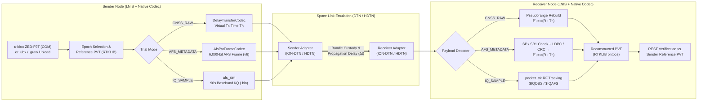

# LNIS — Lunar Navigation & Delay-Tolerant Networking Integration System


-00599C?logo=c&logoColor=white)


**LNIS** is an end-to-end verification and testbed platform designed to evaluate how **Delay/Disruption-Tolerant Networking (DTN / HDTN)** propagation delays affect **GNSS / Lunar Augmented Forward Signal (AFS)** navigation data and **Position, Velocity, and Time (PVT)** solutions.

Specifically, LNIS verifies two core engineering hypotheses:
1. **Bit-Exact Frame & Payload Integrity over DTN/HDTN**: Whether raw GNSS observations (`GNSS_RAW`), 6,000-bit NASA LunaNet AFS frames (`AFS_METADATA`), and 90-second RF baseband I/Q sample streams (`IQ_SAMPLE`) are transported, decoded, and reconstructed without corruption across ION-DTN and HDTN bundle pipelines.
2. **Common Propagation Delay Absorption into Receiver Clock Bias ($dt_r$)**: When a uniform network transmission delay ($\Delta t = R - S$) is injected into satellite pseudoranges ($P'_i = P_i + c\Delta t$), whether the Single Point Positioning (SPP) least-squares solver absorbs the common range offset $c\Delta t$ directly into the **Receiver Clock Bias ($dt_r$)** while preserving the 3D ECEF position $(x, y, z)$.

> [!NOTE]
> LNIS is an **engineering verification system for delay-injected pseudorange and frame transport**, not a simulator of future lunar orbital dynamics or absolute geodetic survey accuracy. Both Reference PVT (sender) and Reconstructed PVT (receiver) are computed from raw pseudorange/ephemeris inputs using the embedded RTKLIB SPP engine rather than relying on receiver hardware `UBX-NAV-PVT` outputs.

---

## Table of Contents

1. [Standards, Specifications & Open-Source References](#1-standards-specifications--open-source-references)
2. [System Architecture & End-to-End Pipeline](#2-system-architecture--end-to-end-pipeline)
3. [Mathematical Model: Delay Injection & Clock Bias Absorption](#3-mathematical-model-delay-injection--clock-bias-absorption)
4. [AFS 6,000-Bit Frame Specification (`LNIS-AFS-GNSS-v6`)](#4-afs-6000-bit-frame-specification-lnis-afs-gnss-v6)
5. [Deployment & Node Configuration](#5-deployment--node-configuration)
6. [Operational Workflow & Trial Execution](#6-operational-workflow--trial-execution)
7. [Build, Native Compilation & Verification](#7-build-native-compilation--verification)
8. [Troubleshooting & Diagnostics](#8-troubleshooting--diagnostics)
9. [License & Third-Party Notices](#9-license--third-party-notices)

---

## 1. Standards, Specifications & Open-Source References

Every physical-layer frame structure, forward error correction (FEC) code, navigation bit allocation, and positioning algorithm in LNIS is grounded in official aerospace standards and peer-reviewed open-source implementations:

| Subsystem / Domain | Implemented Specification & Mechanism | Authoritative Standard / Open-Source Reference |
| :--- | :--- | :--- |
| **AFS Physical Frame & Subframe Architecture** | • 6,000-symbol physical frame (`SP` 68b + `SB1` 52b + `SB2` 2,400b + `SB3` 1,740b + `SB4` 1,740b)<br>• 500 symbols/sec transmission rate (12-second frame period) | • **NASA LunaNet Signal-In-Space (LSIS) Recommended Standard — Volume A: Augmented Forward Signal (AFS), Version 1.0** ([NASA Technical Document, Feb 2025](https://www.nasa.gov/wp-content/uploads/2025/02/lunanet-signal-in-space-recommended-standard-augmented-forward-signal-vol-a.pdf))<br>• **NASA LSIS Baseline V5.0 (Detailed Specification)**, *pp. 34–38 (Section 3.2 Frame Structure, Figure 9, Tables 12–15)* |
| **Synchronization Pattern (`SP`, 68 bits)** | • Fixed 68-bit hex sequence `0xCC63F74536F49E04A` (MSB-first)<br>• Minimum aperiodic autocorrelation peak sidelobe (PSL = 4) for frame boundary lock and phase ambiguity resolution | • **NASA LSIS Vol. A v1.0 / Baseline V5.0**, *Table 12 (68-bit Synchronization Pattern, p. 35)*<br>• **S. E. Kocabas & A. Atalar (2003)**, *"Binary sequences with low aperiodic autocorrelation for synchronization"*, IEEE Communications Letters, Vol. 7, No. 1, pp. 36–38 |
| **Subframe 1 (`SB1`, 52 bits)** | • 9-bit data (`FID` 2 bits + `TOI` 7 bits)<br>• Uncoded MSB (`FID[1]`) + $(51, 8)$ Systematic BCH encoding (generator polynomial $763_8$ (standard notation)) + bit-by-bit XOR mask | • **NASA LSIS Vol. A v1.0 / Baseline V5.0**, *Section 3.3 (Subframe 1 BCH (51,8) Encoding, pp. 35–36)* |
| **Subframes 2, 3 & 4 (`SB2`–`SB4`, 5,880 bits)** | • 24-bit `CRC-24Q` (`0x1864CFB`) error detection<br>• AFS SF2/SF3 LDPC parity-check matrices with the specified puncturing<br>• $98 \times 60$ Block Interleaver ($5,880$ symbols: 60 rows × 98 columns, row-write, column-read) | • **NASA LSIS Vol. A v1.0 / Baseline V5.0**, *Sections 3.4–3.6 (CRC-24Q, LDPC Encoding & $98 \times 60$ Block Interleaver, pp. 36–38)* |
| **AFS Baseband Modulation, PRN Codes & RF Tracking** | • Weil-based 10,230-chip PRN sequences (`008_Weil1500hex210prns.txt`)<br>• I/Q baseband signal synthesis (`afs_sim`) and asynchronous FFT/correlator signal acquisition & tracking (`pocket_trk`) | • **LANS-AFS-SIM** ([`osqzss/LANS-AFS-SIM`](https://github.com/osqzss/LANS-AFS-SIM), Copyright © 2025 Takuji Ebinuma)<br>• **PocketSDR-AFS** ([`osqzss/PocketSDR-AFS`](https://github.com/osqzss/PocketSDR-AFS), Copyright © 2021–2025 T. Takasu & T. Ebinuma)<br>• **LDPC-codes** ([`radfordneal/LDPC-codes`](https://github.com/radfordneal/LDPC-codes), Radford M. Neal, commit `74a8e28`) |
| **GPS L1 C/A Navigation Message (LNAV)** | • 300-bit LNAV Subframes 1–3 (Week, ITOW, SV Clock, Broadcast Ephemeris)<br>• Subframe 4 Page 18 (8-parameter Klobuchar Ionospheric Correction $\alpha_0..\alpha_3, \beta_0..\beta_3$) | • **IS-GPS-200N** *(Navstar GPS Space Segment / Navigation User Segment Interfaces)*, *Section 20.3.3 (Subframes 1–3 Ephemeris & Subframe 4 Page 18 Ionospheric Model)* |
| **GNSS Receiver Raw Binary Protocol (UBX)** | • `UBX-RXM-RAWX` (Multi-GNSS raw pseudorange, carrier phase, Doppler, $C/N_0$, tracking lock status)<br>• `UBX-RXM-SFRBX` (Raw navigation subframe words) & `UBX-MON-VER` (Hardware/firmware inspection) | • **u-blox ZED-F9T-10B Integration Manual**, Doc. `UBX-20033630`, *Section 3.12.1.2 (Broadcast Navigation Data `UBX-RXM-SFRBX` & Raw Measurements `UBX-RXM-RAWX`)* |
| **Single Point Positioning (SPP) PVT Solver** | • Iterated Weighted Least Squares (Gauss-Newton) estimation of 4 unknowns $(x, y, z, c \cdot dt_r)$ + 3D velocity $(v_x, v_y, v_z)$ from Doppler<br>• Earth rotation (Sagnac effect), relativistic clock correction, Klobuchar ionospheric delay, and Saastamoinen tropospheric delay | • **RTKLIB 2.4.3** (`src/pntpos.c`, `src/ephemeris.c`, `src/rtkcmn.c`, Copyright © 2007–2020 T. Takasu; integrated via PocketSDR-AFS `sdr_pvt.c`) |
| **Space Internetworking (DTN / HDTN)** | • Bundle Protocol (BPv6 / BPv7), TCPCL / LTP convergence layers, Custody Transfer / ACS, SDR heap & pipeline buffer control | • **IETF RFC 5050** (BPv6) / **RFC 9171** (BPv7)<br>• **CCSDS 734.2-B-1** *(CCSDS Bundle Protocol Specification)*<br>• **NASA ION-DTN** *(Interplanetary Overlay Network)* & **NASA HDTN** *(High-Rate Delay Tolerant Networking)* |

---

## 2. System Architecture & End-to-End Pipeline

LNIS operates as two independent, symmetric node instances (**Sender Node** and **Receiver Node**), each paired with an external DTN/HDTN adapter daemon.



### Shared AFS / I/Q calculation

AFS and I/Q use one frame layout (Type 63, version 6; SB4 670/846 bits). GPS L1 C/A PRN signal channels remain separate. I/Q frames store a generation anchor A and virtual transmit time T=A−P/c. After actual RF frame decoding, the receiver rebases T to trial start S and computes P′=c×(R−[T+S−A]) using the original frame Doppler. Time spent waiting after file generation and time spent decoding are excluded; R is completion of the receive request body. RF tracking measurements remain separate diagnostics.

Sender dispatch checks file existence, size and format, and reuses the generation SHA-256 without re-reading the complete file. Receiver SHA-256 checks before and after decoding remain mandatory. Full hash progress includes bytes read, elapsed time and throughput. Changes to the sender file after generation are detected at the receiver, not during dispatch.

Only GPS L1 C/A is used for new PVT calculations. Other constellations remain visible as received data. Existing results and files are retained; older I/Q layouts must be regenerated for new trials. Sender/receiver PC clocks must be synchronized.

### Trial Modes Summary

| Trial Type | Payload Transmitted via DTN/HDTN Adapter | Receiver Processing Pipeline |
| :--- | :--- | :--- |
| **`GNSS_RAW`** | JSON containing 1 selected epoch of observations where raw pseudoranges $P_i$ are replaced by virtual transmission timestamps $T^*_i$, plus broadcast navigation subframes (`LNIS-DELAY-RAW-v2`). | Reconstructs delayed pseudorange $P'_i = c(R - T^*_i)$ at arrival time $R \rightarrow$ computes PVT $\rightarrow$ compares against Sender Reference. |
| **`AFS_METADATA`** | Per-satellite **6,000-bit AFS physical frames** (`LNIS-AFS-GNSS-v6`, 750 bytes/SV) containing consolidated LNAV ephemeris, perturbation, and clock data (`SB2`, 801/1,176b), standard `0101` padding (`SB3`, 846b), and virtual transmission timestamps (`SB4`, 670/846b). Original pseudoranges and Reference PVT are **excluded** from the payload. | Checks packed `SP`/`SB1` fields, decodes $98\times60$ interleaved LDPC blocks (`SB2`–`SB4`), reconstructs $P'_i = c(R - T^*_i)$, computes PVT, and fetches Sender Reference via out-of-band REST for verification. |
| **`IQ_SAMPLE`** | Metadata manifest (`LNIS-IQ-FILE-v3`: file path, size, SHA-256) referencing a 90-second synthesized RF I/Q binary file generated by `afs_sim`. | Verifies file integrity $\rightarrow$ executes `pocket_trk` baseband correlator tracking $\rightarrow$ decodes `$IQAFS` frames and reconstructs common-delay pseudoranges; `$IQOBS` stays diagnostic $\rightarrow$ computes `AFS_IQ_FRAME_PVT-v3`. |

---

## 3. Mathematical Model: Delay Injection & Clock Bias Absorption

### 3.1 Dual Role of Satellite Transmission Time vs. Virtual Delayed Time
A critical architectural distinction in LNIS is how two different timestamps are used during PVT computation:

1. **Original GNSS Observation Epoch ($t_0$, carried in `SB4`)**:
   - Preserves the RAWX observation epoch. It is distinct from satellite transmission time and from the trial start timestamp.
   - RTKLIB estimates satellite transmission time from the observation epoch and pseudorange, then applies satellite clock corrections and ephemeris to compute satellite coordinates. `SB1`/`SB2` do not carry each satellite's original transmission timestamp.
2. **Virtual Delayed Transmission Time ($T^*_i$, carried in `SB4` / `DelayTransferCodec`)**:
   - Synthesized at the moment the DTN trial starts ($S$) by subtracting each satellite's original travel time ($P_i / c$) from $S$:
     $$T^*_i = S - \frac{P_i}{c}$$
   - When the bundle arrives at the Receiver Node at timestamp $R$ (after experiencing network delay $\Delta t = R - S$), the receiver computes the **delay-injected pseudorange ($P'_i$)**:
     $$P'_i = c \cdot (R - T^*_i) = c \cdot \left(R - S + \frac{P_i}{c}\right) = P_i + c\Delta t$$

### 3.2 4-Unknown Simultaneous Equations & Clock Bias Absorption
In RTKLIB's Single Point Positioning solver (`pntpos.c:estpos()`), the pseudorange observation equation for satellite $i$ ($i = 1, \dots, N$, where $N \ge 4$) is linearized around the receiver's state vector $\mathbf{x} = [x, y, z, c \cdot dt_r]^T$:

$$P'_i = \underbrace{\sqrt{(X_i - x)^2 + (Y_i - y)^2 + (Z_i - z)^2}}_{\text{Geometric Range } \rho_i(x,y,z)} + c \cdot dt_{r,\text{rx}} - c \cdot dt^s_i + I_i + T_i + \varepsilon_i$$

Substituting $P'_i = P_i + c\Delta t$ into the system of $N$ equations:

$$P_i + c\Delta t = \rho_i(x, y, z) + c \cdot (dt_{r,\text{ref}} + \Delta t) - c \cdot dt^s_i + I_i + T_i + \varepsilon_i$$

Because $c\Delta t$ is **identical across all satellites** in the epoch, the partial derivatives with respect to receiver coordinates $(\frac{\partial \rho_i}{\partial x}, \frac{\partial \rho_i}{\partial y}, \frac{\partial \rho_i}{\partial z})$ remain invariant, whereas the partial derivative with respect to the receiver clock bias term $c \cdot dt_r$ is **1** for every satellite. Consequently:
- **3D ECEF Position $(x, y, z)$**: Converges to the original terrestrial coordinates (up to minor Sagnac/iteration coupling if epoch time is shifted).
- **Receiver Clock Bias ($dt_{r,\text{rx}}$)**: Absorbs the entire network propagation delay $\Delta t$:
  $$dt_{r,\text{rx}} \approx dt_{r,\text{ref}} + \Delta t$$
- **Time Residual Verification Metric**:
  $$\text{Time Residual} = (dt_{r,\text{rx}} - dt_{r,\text{ref}}) - \Delta t$$

```text
t₀ : Original GNSS Observation Epoch (Week / TOW)
S  : Trial Start Timestamp (Sender)
R  : Bundle Payload Arrival Timestamp (Receiver)
Δt : End-to-End Propagation Delay = R − S
c  : Speed of Light = 299,792,458 m/s

[Sender]   Virtual Tx Time       : T*ᵢ = S − (Pᵢ / c)
[Receiver] Delayed Pseudorange   : P′ᵢ = c × (R − T*ᵢ) = Pᵢ + c·Δt
           Effective GNSS Epoch  : t₀ + Δt
[Verify]   Clock Bias Residual   : (Receiver Clock Bias − Reference Clock Bias) − Δt
```

> [!IMPORTANT]
> Delay measurement $\Delta t = R - S$ includes sender preparation, adapter queuing, and DTN/HDTN link transit after pressing **Start Trial**, but excludes pre-trial idle time after GNSS capture and post-reception PVT computation time.

---

## 4. AFS 6,000-Bit Frame Specification (`LNIS-AFS-GNSS-v6`)

In `AFS_METADATA` mode, LNIS encodes one **6,000-bit (750-byte) physical frame per observed GPS L1 C/A satellite** following **NASA LSIS Volume A v1.0 / Baseline V5.0 (pp. 34–38)** for the physical layer, FEC pipeline, and `SB2` ephemeris/perturbation consolidation (`MSG-G4 CED` + `MSG-G8 ToT`), while keeping `SB3` as standard `0101` padding and utilizing `SB4` as an LNIS testbed extension to carry delay-test observation parameters.

### 4.1 Physical Layer & FEC Pipeline

```text
[Uninterleaved Header: 120 bits]
  ├── SP  (Synchronization Pattern) : 68 bits  (Fixed Hex: 0xCC63F74536F49E04A)
  └── SB1 (Frame ID & Time of Interval) : 52 bits  (1b FID[1] + 51b BCH(51,8) of FID[0]||TOI[6:0])

[98 × 60 Block Interleaved Payload: 5,880 bits]
  ├── SB2 (Unified Clock, Ephemeris & Perturbations) : 1,176 data bits + 24b CRC-24Q = 1,200b ──(AFS SF2 LDPC)──► 2,400 symbols
  ├── SB3 (Almanac Slot / Standard 0101 Padding)     :   846 data bits + 24b CRC-24Q =   870b ──(AFS SF3 LDPC)──► 1,740 symbols
  └── SB4 (LNIS Delayed Obs & Iono)                  :   846 data bits + 24b CRC-24Q =   870b ──(AFS SF3 LDPC)──► 1,740 symbols
                                                                                                                  Total = 5,880 symbols
  └──► Written into 60 rows × 98 columns matrix (row-wise write, column-wise read)

[Final Transmitted Physical Frame: 6,000 bits = 750 Bytes (12 seconds @ 500 sps)]
  [ SP (68b) ][ SB1 (52b) ][ Interleaved SB2 · SB3 · SB4 (5,880b) ]
```

| Subframe | Pre-FEC Data Bits | CRC-24Q | Post-LDPC & Puncturing | Standard / Role |
| :--- | :---: | :---: | :---: | :--- |
| **`SP`** | 68 bits | — | **68 symbols** | NASA LSIS Table 12 fixed synchronization sequence (`0xCC63F74536F49E04A`) |
| **`SB1`** | 9 bits (`FID` 2b + `TOI` 7b) | — | **52 symbols** | NASA LSIS Section 3.3 frame identifier & 12-second Time of Interval |
| **`SB2`** | 1,176 bits | 24 bits | **2,400 symbols** | NASA Official (`MSG-G4 CED` & `MSG-G8 ToT`): Full ephemeris + perturbations + clock; LNIS preserves open-source 284b primary layout (`Bit 0~283`) + consolidates 517b supplementary LNAV (`Bit 284~800`) = **801 / 1,176b** (375b `0101` padding) |
| **`SB3`** | 846 bits | 24 bits | **1,740 symbols** | NASA Official (`MSG-G5/G6` Almanac, time/coord transforms, Alerts); Open-source & LNIS: **846 bits standard `0101...` alternating dummy padding** |
| **`SB4`** | 846 bits | 24 bits | **1,740 symbols** | NASA Official (`MSG-G1/G2/G3` Network Access/Health/Antenna, LunaSAR); **LNIS Extension**: Virtual Tx Time ($T^*_i$), Doppler, $C/N_0$, Klobuchar Iono & Trial Start ($S$) |
| **Total** | **2,945 bits** | **72 bits** | **6,000 symbols (750 B)** | Complete 12-second NASA LSIS AFS Frame |

### 4.2 Bit-Level Allocation of `SB2`, `SB3` & `SB4`

`SB2` contains a 1,176-bit pre-CRC data payload consolidating the entire 720-bit GPS LNAV ephemeris, clock, and perturbation data (`801 bits` used + `375 bits` padding). `SB3` (846 bits) is filled with standard `010101...` padding, and `SB4` (846 bits) carries the LNIS observation/delay payload.

| Block | Total Data Bits | Bit-Field Breakdown (MSB to LSB) |
| :--- | :---: | :--- |
| **Common Header** | **57 bits** | `type` (6b, fixed `63`) + `version` (8b, `6` for AFS and I/Q) + `block` (3b, `2`=SB2 supplementary / `4`=SB4) + `epochIndex` (32b) + `prn` (8b) |
| **`SB2` Payload** | **1,176 bits** | • **Primary Header & 10 Elements (`Bit 0~283`, 284b)**: `Week` (13b) + `ITOW` (9b) + 10 open-source `eph2sbf` primary fields (`t_oe`, `e` [31b], `sqrtA`, `i_0`, `Omega_0`, `omega`, `M_0`, `t_oc`, `a_f0`, `a_f1`, 262b)<br>• **Common Header (`Bit 284~340`, 57b)**: `type=63`, `version=6`, `block=2`, `epochIndex`, `prn`<br>• `hasNavigation` flag (`Bit 341`, 1b)<br>• **Supplementary GPS LNAV Perturbations & Clock (`Bit 342~800`, 459b)**: $C_{rs}, C_{uc}, C_{us}, C_{ic}, C_{is}, C_{rc}$, $\Delta n, \dot{\Omega}, IDOT$, $a_{f2}, T_{GD}$, IODE/IODC/SV Health/URA flags, and $e$ LSB<br>• Alternating `0101...` padding (`Bit 801~1175`, 375b) |
| **`SB3` Payload** | **846 bits** | • **Standard `0101...` alternating dummy padding (`Bit 0~845`, 846b)** (matches open-source `afs_sim.c`; all LNAV perturbation parameters are consolidated into `SB2`) |
| **`SB4` Payload (v6)** | **846 bits** | • **Common Header** (57b, `block=4`)<br>• `observationOrder` (8b) + `week` (16b) + `towSeconds` (64b IEEE-754 double)<br>• **Virtual Transmission Time $T^*_i$** (114b: 64-bit signed Unix seconds + 50-bit unsigned femtoseconds)<br>• `dopplerHz` (32b float) + `cn0DbHz` (8b) + `trackingStatus` (8b)<br>• `hasIonosphere` flag (1b) + `ionosphereSourcePrn` (8b) + **Klobuchar Ionospheric Page** (240b: 10 words $\times$ 24 bits from LNAV SF4 Page 18)<br>• **Frame Anchor Timestamp $A$** (AFS: trial start S; I/Q: generation anchor rebased to S) (114b: 64-bit Unix seconds + 50-bit femtoseconds)<br>• Alternating `0101...` padding (176b) |

> [!TIP]
> **Why 114-bit Femtosecond Timestamps?**
> Light travels approximately $0.3\text{ m}$ per nanosecond. Standard millisecond or microsecond timestamps introduce quantization noise into $P'_i = c(R - T^*_i)$. Representing $T^*_i$ and $S$ with **64-bit Unix seconds + 50-bit femtoseconds ($10^{-15}\text{ s}$)** eliminates floating-point and timestamp serialization rounding across Java, H2 (`TIMESTAMP(9)`), and AFS bitstreams.

---

## 5. Deployment & Node Configuration

LNIS is deployed as two standalone nodes (**Sender PC** and **Receiver PC**). Each PC runs its own **LNIS Server container** (`lnis-node`) and communicates with an external **DTN / HDTN Adapter**. Databases (`H2`) and exchange directories are isolated per node.

### 5.1 Environment Configuration (`.env`)

Unpack `build/distributions/lnis-node-linux.zip` on each target machine, copy `.env.example` to `.env`, and configure the following variables (see [deployment/node/README.md](deployment/node/README.md)):

| Environment Variable | Description | Example |
| :--- | :--- | :--- |
| `LNIS_NODE_ROLE` | Operational role of the current node (`sender` or `receiver`) | `sender` |
| `LNIS_SERVER_PORT` | HTTP/WebSocket listening port for the LNIS web UI and REST APIs | `8088` |
| `LNIS_NODE_BASE_URL` | Self-reachable base URL of this LNIS instance | `http://192.168.1.101:8088` |
| `LNIS_NODE_PEER_URL` | Base URL of the counterpart LNIS node (used for clock sync & Reference PVT verification) | `http://192.168.1.102:8089` |
| `LNIS_NODE_MANAGEMENT_TOKEN` | Shared secret token for inter-node management REST calls (must match on both nodes) | `lnis-mgmt-secret-token` |
| `dtn_adapter` | Default endpoint URL of the external DTN/HDTN sender adapter | `http://192.168.1.154:8080` |
| `LNIS_DTN_SEND_TOKEN` | Bearer token sent by LNIS to the external sender adapter | `adapter-send-token` |
| `LNIS_DTN_RECEIVE_TOKEN` | Bearer token required by `/lnis/api/v1/dtn/receive` from the receiver adapter | `adapter-recv-token` |
| `LNIS_IQ_ENABLED` | Enables 90-second RF I/Q file synthesis and tracking (`true` / `false`) | `true` |

### 5.2 Starting the Containers

```bash
# Run inside the unpacked deployment directory (not the source repository root)
docker compose up -d --build
docker compose ps
```

- **Web UI Entrypoint**: `http://<NODE_IP>:<LNIS_SERVER_PORT>/` (automatically routes to `/dtn-sender` or `/dtn-receiver` based on `LNIS_NODE_ROLE`)
- **Interactive System Architecture & Frame Guide**: `http://<NODE_IP>:<LNIS_SERVER_PORT>/dtn-intro`
- **Hardware GNSS Serial Mapping**:
  - **Windows Host + WSL2 Docker**: Launch using `START.cmd` or `start.ps1` to start the Windows COM Serial Bridge alongside Docker (see [WINDOWS-SERIAL-BRIDGE.md](deployment/node/WINDOWS-SERIAL-BRIDGE.md)).
  - **Native Linux Host**: Configure `LNIS_SERIAL_DEVICE=/dev/serial/by-id/...` in `.env` (see [WSL2-GNSS.md](deployment/node/WSL2-GNSS.md)).

---

## 6. Operational Workflow & Trial Execution

1. **Adapter & Route Configuration**:
   - Open the Settings Drawer (`⚙️`), verify the counterpart LNIS peer address, adapter URL, trial payload type (`GNSS RAW`, `AFS Frame`, or `I/Q Sample`), and routing engine (`DTN → HDTN`, `DTN → DTN`, `HDTN → DTN`, or `HDTN → HDTN`).
   - Engine parameters (e.g., ION SDR Heap Size, HDTN Pipeline Bundle Capacity, Custody/Deletion Policy) are persisted in browser storage and transmitted in the adapter request header/body.
2. **GNSS Data Ingestion**:
   - **Live Capture**: Connect a u-blox ZED-F9T receiver via COM port (`38400` baud default) and click **1-Epoch Capture** (up to 120s timeout to collect `RXM-RAWX` + `RXM-SFRBX` subframes).
   - **File Upload**: Upload a `.ubx` file (up to 64 MiB / 1,000 epochs) or `.graw` file (up to 1 MiB) and select the target observation epoch.
   - Inspect the computed **Reference PVT** (ECEF position, velocity, receiver clock bias, and per-satellite LNAV SF1–3 readiness).
   - Saved I/Q files retain their stored modification order after restart. The list shows up to 50 entries with the active generation first; older files remain on disk.
3. **Node Clock Calibration (`Time Sync → Apply`)**:
   - Before starting delay trials, click **Time Sync → Apply** on **both** Sender and Receiver UIs while no trial is active.
   - This calibrates the internal trial clock offset against GNSS/peer time without altering the host OS clock, preventing negative or skewed $\Delta t$ measurements.
4. **Trial Execution (`Start Trial`)**:
   - Each click registers a unique `testId` and dispatches the bundle to the external adapter.
   - Once the adapter accepts the dispatch, subsequent trials can be queued immediately without waiting for prior bundles to arrive.
   - **다음 전송**은 설정한 시험 유형·경로를 표시합니다. 이력을 선택해도 다음 전송 설정은 바뀌지 않습니다. 선택한 시험의 유형은 상태 표시와 목록의 `[RAW]`·`[AFS]`·`[I/Q]`에서 확인합니다.
   - 수신부는 사전 등록 정보로 본문 도착 전에도 유형·경로를 표시합니다. 이전 기록의 누락 정보는 기동 시 송신부와 시험 ID·전송 해시·비교 조건이 일치할 때만 보완하며, 확인할 수 없는 유형은 **유형 미확인**으로 표시합니다.
5. **Reception & Verification**:
   - Upon bundle arrival at `/lnis/api/v1/dtn/receive`, the Receiver Node decodes the payload, reconstructs $P'_i$, runs RTKLIB SPP, and queries the Sender Node for the original Reference PVT.
   - Inspect **Payload Integrity (`PASS`/`FAIL`)**, **PVT Status (`MEASURED`/`PARTIAL`/`INCONCLUSIVE`)**, **3D Position/Velocity Deltas**, and **Clock Bias Residual**.
   - I/Q 수신 관측값은 복호된 AFS의 1 Epoch 관측·항법정보와 RF 추적값을 표시합니다. 송신 원본 GNSS를 별도로 가져와 대조하지 않으며, **파일 일치(크기·SHA-256)**와 **Reference PVT 비교 결과**를 함께 표시합니다. 프레임에 없는 수신기 필드는 표시하지 않습니다.

---

## 7. Build, Native Compilation & Verification

LNIS uses a reproducible, containerized multi-stage build (`native/Dockerfile`) to compile its C/C++ native libraries (`libLnisAfsCodec.so` for Linux x86-64, `LnisAfsCodec.dll` for Windows x86-64, and `afs_sim` / `pocket_trk` executables) from unmodified upstream vendor snapshots (`native/vendor/`) and auditable patch sets (`native/patches/`).

### 7.1 Gradle Build Tasks

```powershell
# 1. Compile Linux .so, I/Q binaries, and Windows .dll inside isolated Docker toolchain
.\gradlew.bat nativeBuild

# 2. Run Java, ArchUnit, JS smoke, Playwright browser, native-source and deployment checks
# Install Playwright separately; set PLAYWRIGHT_MODULE if it is outside Node module resolution.
# Example: $env:PLAYWRIGHT_MODULE = "C:\tools\node_modules\playwright"
.\gradlew.bat check bootJar -PnativeCandidate=build/native-pvt

# 3. Package standalone Linux deployment archive (build/distributions/lnis-node-linux.zip)
.\gradlew.bat linuxNodeDistZip

# 4. Synchronize static documentation page (src/main/resources/static/dtn-intro.html -> docs/index.html)
.\gradlew.bat syncIntroDocs verifyIntroDocs
```

`check` verifies documentation without modifying it. `syncIntroDocs` copies the service guide and both logo assets into `docs/`; it does not publish a website. `browserTest` runs the existing browser checks independently against local mock APIs.

Large I/Q replay fixtures are optional and are not created by `check`. Tests that require missing fixtures are reported as skipped:

| Verification | Input | Command |
| :--- | :--- | :--- |
| F9T source | Pinned gzip-compressed UBX recording (SHA-256 checked by `F9tExampleTest`) | `./gradlew test --tests server.afs.F9tExampleTest -Pf9tExampleSource=<path> --rerun-tasks` |
| Decoded I/Q common-delay PVT | `LNIS_IQ_SMOKE_DIRECTORY`: `source.json`, `tracking.log` | `./gradlew test --tests server.iq.AfsPvtFrameIntegrationTest --rerun-tasks` |
| Native diagnostic removal comparison | `LNIS_NATIVE_LOG_COMPARISON`: before/after tracking fixtures | `./gradlew test --tests server.iq.NativeDiagnosticRemovalTest --rerun-tasks` |
| File replay observation retention | `LNIS_IQ_REPLAY_DIRECTORY`: source and tracking fixtures | `./gradlew test --tests server.iq.NativeFileReplayIntegrationTest --rerun-tasks` |

Set environment variables before starting Gradle. Use `gradlew.bat` on Windows and add `-PnativeCandidate=build/native-pvt` when testing rebuilt Windows libraries. These fixture tests replay recorded outputs; they do not replace a live serial/adapter/RF test.

### 7.2 Repository Structure

```text
LnisServer/
├── src/main/java/server/
│   ├── afs/          # NASA LSIS AFS 6,000-bit frame codecs (AfsPvtFrameCodec, AfsPvtPayload, NativeAfsCodec)
│   ├── dtn/          # DTN/HDTN trial state machine, DelayTransferCodec, REST controllers & peer sync
│   ├── gnss/         # UBX-RXM-RAWX / SFRBX parser, GRAW codec, serial capture & u-blox framing
│   ├── iq/           # 90-second RF baseband I/Q generator (afs_sim) & tracker (pocket_trk) orchestration
│   ├── pvt/          # JNA bridge to RTKLIB SPP solver (NativePvtCodec)
│   └── node/         # Inter-node connection health, GNSS clock offset & management security
├── src/main/resources/static/
│   ├── dtn-sender.html    # Sender Node operational dashboard
│   ├── dtn-receiver.html  # Receiver Node operational dashboard
│   ├── dtn-intro.html     # Interactive NASA LSIS AFS & DTN technical specification guide
│   └── assets/dtn/        # ES module frontend logic & stylesheets
├── native/
│   ├── vendor/       # Upstream sources: LANS-AFS-SIM, PocketSDR-AFS (with RTKLIB), LDPC-codes
│   ├── patches/      # Auditable patches (01-korean-comments through 06-file-replay)
│   ├── lnis_afs_codec.c # JNA ABI wrapper for AFS BCH/LDPC/Interleaver encoding & decoding
│   ├── lnis_pvt.c    # JNA ABI wrapper for RTKLIB pntpos() & decode_frame()
│   └── README.md     # Native provenance, SHA-256 verification & patch documentation
└── deployment/node/  # Docker Compose templates, .env.example & Windows Serial Bridge scripts
```

---

## 8. Troubleshooting & Diagnostics

| Symptom / Error | Primary Root Cause & Resolution |
| :--- | :--- |
| **Negative Delay ($\Delta t < 0$) or Large Time Residual** | Clock skew between Sender and Receiver hosts. Terminate active trials and execute **Time Sync → Apply** on both nodes. |
| **`INCONCLUSIVE` PVT Verdict** | Insufficient satellites with complete LNAV Subframes 1–3 ($N < 4$), ephemeris out of validity window, or extreme delay causing Gauss-Newton divergence. Click the **PVT Status** pill to inspect the exact RTKLIB rejection reason. |
| **I/Q generation failure** | Only GPS L1 observations with coherent preceding LNAV Subframes 1–3 are selected. Excluded PRNs are logged; at least four ready satellites are required. Generation failures include the process exit code, output size, and the last 4 KiB of the generator log. |
| **Reference Comparison Pending / Fetch Failed** | Counterpart node is unreachable or `LNIS_NODE_MANAGEMENT_TOKEN` mismatches between `.env` files. Verify Peer Connection status in the Settings Drawer. |
| **HTTP `401` / `403` on Adapter or Node APIs** | Mismatched `LNIS_DTN_SEND_TOKEN`, `LNIS_DTN_RECEIVE_TOKEN`, or `LNIS_NODE_MANAGEMENT_TOKEN`. |
| **COM Port Connection Failure** | Port is locked by another application (e.g., u-center) or Windows Serial Bridge (`start.ps1` / `START.cmd`) is not running. Disconnect in u-center before connecting in LNIS. |

### Inspecting Live Container Logs

```bash
# Tail the last 100 lines of the LNIS node service
docker compose logs --tail 100 -f node
```

- All trial lifecycle events and outbound/inbound adapter JSON payloads are logged at `INFO` level with `testId` and `requestId` correlation tags.
- For verbose HTTP header/polling diagnostics, set `LNIS_HTTP_LOG_LEVEL=DEBUG` in `.env`, restart the container, and revert to `INFO` after inspection.

---

## 9. License & Third-Party Notices

This project integrates and adapts open-source software components distributed under their respective licenses. Full license texts, upstream SHA-256 manifests (`native/UPSTREAM-SHA256.txt`), and source rebuild archives (`licenses/native-sources.zip`) are packaged with every binary distribution:

- **LANS-AFS-SIM**: Copyright © 2025 Takuji Ebinuma (BSD-style 2-Clause License)
- **PocketSDR / PocketSDR-AFS**: Copyright © 2021–2025 T. Takasu & Takuji Ebinuma (BSD 2-Clause License)
- **RTKLIB**: Copyright © 2007–2020 T. Takasu (`native/RTKLIB-README.txt`, BSD 2-Clause License)
- **LDPC-codes**: Copyright © 1995–2012 Radford M. Neal (`native/vendor/LDPC-codes/COPYRIGHT` & `LGPL`, GNU Lesser General Public License v2.1)

See [native/THIRD-PARTY-NOTICES.txt](native/THIRD-PARTY-NOTICES.txt) and [native/README.md](native/README.md) for complete provenance and compliance details.
