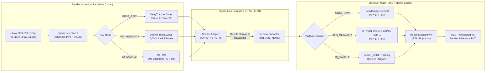

# GNSS 전송 시험

**사용자 설명서:** [웹 설명서](manual/index.html) · [PDF](manual/user-manual.pdf) · [Word](manual/user-manual.docx)

본문은 `manual/index.html`에서 수정합니다. 버전은 **1.0**으로 유지하고 `manual-updated` 날짜를 갱신합니다. `gradlew.bat userManualDistZip`은 검색·화면 검사를 거쳐 HTML·이미지·PDF·Word를 `build/distributions/user-manual.zip`에 묶습니다. 생성에는 Node.js, Playwright/Chromium, Python의 `beautifulsoup4`, `python-docx`, `Pillow`가 필요합니다. 기존 Playwright를 쓰려면 `PLAYWRIGHT_MODULE`에 모듈 경로를 지정합니다.

`gradlew.bat userManualDistZip bootJar`로 설명서와 프로그램을 함께 빌드한 뒤 기존 절차로 배포·재기동합니다. 설명서는 프로그램에 포함됩니다. Word 수정 사항은 HTML 원본에도 반영합니다.


-00599C?logo=c&logoColor=white)


**LNIS** is an end-to-end verification and testbed platform designed to evaluate how **Delay/Disruption-Tolerant Networking (DTN / HDTN)** propagation delays affect **GNSS / Lunar Augmented Forward Signal (AFS)** navigation data and **Position, Velocity, and Time (PVT)** solutions.

Specifically, LNIS verifies two core engineering hypotheses:
1. **Bit-Exact Frame & Payload Integrity over DTN/HDTN**: Whether raw GNSS observations (`GNSS_RAW`), 6,000-bit NASA LunaNet AFS frames (`AFS_METADATA`), and 90-second RF baseband I/Q sample streams (`IQ_SAMPLE`) are transported, decoded, and reconstructed without corruption across ION-DTN and HDTN bundle pipelines.
2. **Common Propagation Delay Absorption into Receiver Clock Bias ($dt_r$)**: When a uniform network transmission delay ($\Delta t = R - S$) is injected into satellite pseudoranges ($P'_i = P_i + c\Delta t$), whether the Single Point Positioning (SPP) least-squares solver absorbs the common range offset $c\Delta t$ directly into the **Receiver Clock Bias ($dt_r$)** while preserving the 3D ECEF position $(x, y, z)$.

> [!NOTE]
> LNIS is an **engineering verification system for delay-injected pseudorange and frame transport**, not a simulator of future lunar orbital dynamics or absolute geodetic survey accuracy. Both Reference PVT (sender) and Reconstructed PVT (receiver) are computed from raw pseudorange/ephemeris inputs using the embedded RTKLIB SPP engine rather than relying on receiver hardware `UBX-NAV-PVT` outputs.

---

## Table of Contents

1. [Standards, Specifications & Open-Source References](#1-standards-specifications--open-source-references)
2. [System Architecture & End-to-End Pipeline](#2-system-architecture--end-to-end-pipeline)
3. [Mathematical Model: Delay Injection & Clock Bias Absorption](#3-mathematical-model-delay-injection--clock-bias-absorption)
4. [AFS 6,000-Bit Frame Specification (`LNIS-AFS-GNSS-v1`)](#4-afs-6000-bit-frame-specification-lnis-afs-gnss-v1)
5. [Deployment & Node Configuration](#5-deployment--node-configuration)
6. [Operational Workflow & Trial Execution](#6-operational-workflow--trial-execution)
7. [Build, Native Compilation & Verification](#7-build-native-compilation--verification)
8. [Troubleshooting & Diagnostics](#8-troubleshooting--diagnostics)
9. [License & Third-Party Notices](#9-license--third-party-notices)

---

## 1. Standards, Specifications & Open-Source References

LNIS reuses the AFS frame and coding structure and the positioning implementations listed below. GPS LNAV packing and delay-test fields are LNIS definitions; they do not establish LunaNet message interoperability or standard certification:

| Subsystem / Domain | Implemented Specification & Mechanism | Authoritative Standard / Open-Source Reference |
| :--- | :--- | :--- |
| **AFS Physical Frame & Subframe Architecture** | • 6,000-symbol physical frame (`SP` 68b + `SB1` 52b + `SB2` 2,400b + `SB3` 1,740b + `SB4` 1,740b)<br>• 500 symbols/sec transmission rate (12-second frame period) | • **NASA LunaNet Signal-In-Space (LSIS) Recommended Standard — Volume A: Augmented Forward Signal (AFS), Version 1.0** ([NASA Technical Document, Feb 2025](https://www.nasa.gov/wp-content/uploads/2025/02/lunanet-signal-in-space-recommended-standard-augmented-forward-signal-vol-a.pdf))<br>• **LunaNet Interoperability Specification Version 5 (framework; LSIS Volume A is its AD1)**, *Section 2.4, pp. 24–34 (frame structure, coding and message allocation)* |
| **Synchronization Pattern (`SP`, 68 bits)** | • Fixed 68-bit hex sequence `0xCC63F74536F49E04A` (MSB-first)<br>• Minimum aperiodic autocorrelation peak sidelobe (PSL = 4) for frame boundary lock and phase ambiguity resolution | • **NASA LSIS Vol. A v1.0**, *Table 12 (68-symbol synchronization pattern, p. 25; marked TBC)*<br>• **S. E. Kocabas & A. Atalar (2003)**, *"Binary sequences with low aperiodic autocorrelation for synchronization"*, IEEE Communications Letters, Vol. 7, No. 1, pp. 36–38 |
| **Subframe 1 (`SB1`, 52 bits)** | • 9-bit data (`FID` 2 bits + `TOI` 7 bits)<br>• Uncoded MSB (`FID[1]`) + $(51, 8)$ BCH encoding (generator polynomial $763_8$ (standard notation)) + bit-by-bit XOR mask | • **NASA LSIS Vol. A v1.0**, *Section 2.4.2 (SB1 BCH encoding and fields, pp. 25–27)* |
| **Subframes 2, 3 & 4 (`SB2`–`SB4`, 5,880 bits)** | • 24-bit `CRC-24Q` (`0x1864CFB`) error detection<br>• AFS SF2/SF3 LDPC parity-check matrices with the specified puncturing<br>• $98 \times 60$ Block Interleaver ($5,880$ symbols: 60 rows × 98 columns, row-write, column-read) | • **NASA LSIS Vol. A v1.0**, *Section 2.4.3.1 (LDPC, CRC and 60-row × 98-column interleaver, pp. 28–31)* |
| **AFS Baseband Modulation, PRN Codes & RF Tracking** | • Weil-based 10,230-chip PRN sequences (`008_Weil1500hex210prns.txt`)<br>• I/Q baseband signal synthesis (`afs_sim`) and asynchronous FFT/correlator signal acquisition & tracking (`pocket_trk`) | • **LANS-AFS-SIM** ([`osqzss/LANS-AFS-SIM`](https://github.com/osqzss/LANS-AFS-SIM), Copyright © 2025 Takuji Ebinuma)<br>• **PocketSDR-AFS** ([`osqzss/PocketSDR-AFS`](https://github.com/osqzss/PocketSDR-AFS), Copyright © 2021–2025 T. Takasu & T. Ebinuma)<br>• **LDPC-codes** ([`radfordneal/LDPC-codes`](https://github.com/radfordneal/LDPC-codes), Radford M. Neal, commit `74a8e28`) |
| **GPS L1 C/A Navigation Message (LNAV)** | • 300-bit LNAV Subframes 1–3 (Week, ITOW, SV Clock, Broadcast Ephemeris)<br>• Subframe 4 Page 18 (8-parameter Klobuchar Ionospheric Correction $\alpha_0..\alpha_3, \beta_0..\beta_3$) | • **IS-GPS-200N** *(Navstar GPS Space Segment / Navigation User Segment Interfaces)*, *Section 20.3.3 (Subframes 1–3 Ephemeris & Subframe 4 Page 18 Ionospheric Model)* |
| **GNSS Receiver Raw Binary Protocol (UBX)** | • `UBX-RXM-RAWX` (Multi-GNSS raw pseudorange, carrier phase, Doppler, $C/N_0$, tracking lock status)<br>• `UBX-RXM-SFRBX` (Raw navigation subframe words) & `UBX-MON-VER` (Hardware/firmware inspection) | • **u-blox ZED-F9T-10B Integration Manual**, Doc. `UBX-20033630`, *Section 3.12.1.2 (Broadcast Navigation Data `UBX-RXM-SFRBX` & Raw Measurements `UBX-RXM-RAWX`)* |
| **Single Point Positioning (SPP) PVT Solver** | • Iterated Weighted Least Squares (Gauss-Newton) estimation of 4 unknowns $(x, y, z, c \cdot dt_r)$ + 3D velocity $(v_x, v_y, v_z)$ from Doppler<br>• Earth rotation (Sagnac effect), relativistic clock correction, Klobuchar ionospheric delay, and Saastamoinen tropospheric delay | • **RTKLIB 2.4.3** (`src/pntpos.c`, `src/ephemeris.c`, `src/rtkcmn.c`, Copyright © 2007–2020 T. Takasu; integrated via PocketSDR-AFS `sdr_pvt.c`) |
| **Space Internetworking (DTN / HDTN)** | • Bundle Protocol (BPv6 / BPv7), TCPCL / LTP convergence layers, Custody Transfer / ACS, SDR heap & pipeline buffer control | • **IETF RFC 5050** (BPv6) / **RFC 9171** (BPv7)<br>• **CCSDS 734.2-B-1** *(CCSDS Bundle Protocol Specification)*<br>• **NASA ION-DTN** *(Interplanetary Overlay Network)* & **NASA HDTN** *(High-Rate Delay Tolerant Networking)* |

---

## 2. System Architecture & End-to-End Pipeline

LNIS operates as two independent, symmetric node instances (**Sender Node** and **Receiver Node**), each paired with an external DTN/HDTN adapter daemon.



### Shared AFS / I/Q calculation

AFS and I/Q retain one frame layout (Type 63, version 1; SB4 670/846 bits) and separate GPS PRN signal channels. AFS reconstructs its delayed pseudoranges from SB4 virtual transmit times.

New I/Q files use the same SB4-derived starting pseudorange and Doppler to anchor the waveform. A build-time patch adjusts only the LNIS generator connection in a temporary source copy; vendored sources and modulation/FEC algorithms remain unchanged. The existing 90-second orbit/motion evolution is retained after the initial range and range-rate correction. Original RAWX C/N0 is not quantitatively reproduced by the waveform.

The I/Q receiver uses actual RF-tracked pseudorange, Doppler and C/N0, with navigation recovered from CRC-verified AFS frames. It selects the first solvable RF epoch and calculates both an RF baseline PVT and a delayed PVT using P′=P_RF+c×(R−S) and the corresponding shifted GNSS epoch. The main comparison is between those two RF solutions. Sender Reference PVT is retained separately; it is not substituted for an RF solution. Waiting after generation and receiver decoding time are excluded from the injected delay; R is completion of the receive request body.

Sender dispatch checks file existence, size and format, and reuses the generation SHA-256 without re-reading the complete file. The receiver verifies the complete SHA-256 once before decoding, then checks file size, modification time and identity after decoding. The shared file must remain unchanged during processing. Full hash progress includes bytes read, elapsed time and throughput. Changes to the sender file after generation are detected at the receiver, not during dispatch.

Only GPS L1 C/A is used for new PVT calculations. Other constellations remain visible as received data. Receiver waiting has no expiry, but a long delay can exceed ephemeris-selection or solver conditions and yield no valid PVT. Existing results and files are retained; older I/Q layouts must be regenerated for new trials. Sender/receiver PC clocks must be synchronized.

### Trial Modes Summary

| Trial Type | Payload Transmitted via DTN/HDTN Adapter | Receiver Processing Pipeline |
| :--- | :--- | :--- |
| **`GNSS_RAW`** | JSON containing 1 selected epoch of observations where raw pseudoranges $P_i$ are replaced by virtual transmission timestamps $T^*_i$, plus broadcast navigation subframes (`LNIS-GRAW-DELAY-v1`). | Reconstructs delayed pseudorange $P'_i = c(R - T^*_i)$ at arrival time $R \rightarrow$ computes PVT $\rightarrow$ compares against Sender Reference. |
| **`AFS_METADATA`** | Per-satellite **6,000-bit AFS physical frames** (`LNIS-AFS-GNSS-v1`, 750 bytes/SV) containing consolidated LNAV ephemeris, perturbation, and clock data (`SB2`, 801/1,176b), standard `0101` padding (`SB3`, 846b), and virtual transmission timestamps (`SB4`, 670/846b). Original pseudoranges and Reference PVT are **excluded** from the payload. | Checks packed `SP`/`SB1` fields, decodes $98\times60$ interleaved LDPC blocks (`SB2`–`SB4`), reconstructs $P'_i = c(R - T^*_i)$, computes PVT, and fetches Sender Reference via out-of-band REST for verification. |
| **`IQ_SAMPLE`** | Metadata manifest (`LNIS-IQ-FILE-v1`: file path, size, SHA-256) referencing a 90-second synthesized RF I/Q binary file generated by `afs_sim`. | Verifies file integrity $\rightarrow$ executes `pocket_trk` baseband correlator tracking $\rightarrow$ uses `$IQAFS` navigation and `$IQOBS` RF observations $\rightarrow$ compares RF baseline/delayed PVT (`AFS_IQ_RF_DELAY-v1`). |

---

## 3. Mathematical Model: Delay Injection & Clock Bias Absorption

### 3.1 Dual Role of Satellite Transmission Time vs. Virtual Delayed Time
A critical architectural distinction in LNIS is how two different timestamps are used during PVT computation:

1. **Original GNSS Observation Epoch ($t_0$, carried in `SB4`)**:
   - Preserves the RAWX observation epoch. It is distinct from satellite transmission time and from the trial start timestamp.
   - RTKLIB estimates satellite transmission time from the observation epoch and pseudorange, then applies satellite clock corrections and ephemeris to compute satellite coordinates. `SB1`/`SB2` do not carry each satellite's original transmission timestamp.
2. **Virtual Delayed Transmission Time ($T^*_i$, carried in `SB4` / `DelayTransferCodec`)**:
   - Synthesized at the moment the DTN trial starts ($S$) by subtracting each satellite's original travel time ($P_i / c$) from $S$:
     $$T^*_i = S - \frac{P_i}{c}$$
   - When the bundle arrives at the Receiver Node at timestamp $R$ (after experiencing network delay $\Delta t = R - S$), the receiver computes the **delay-injected pseudorange ($P'_i$)**:
     $$P'_i = c \cdot (R - T^*_i) = c \cdot \left(R - S + \frac{P_i}{c}\right) = P_i + c\Delta t$$

### 3.2 4-Unknown Simultaneous Equations & Clock Bias Absorption
In RTKLIB's Single Point Positioning solver (`pntpos.c:estpos()`), the pseudorange observation equation for satellite $i$ ($i = 1, \dots, N$, where $N \ge 4$) is linearized around the receiver's state vector $\mathbf{x} = [x, y, z, c \cdot dt_r]^T$:

$$P'_i = \underbrace{\sqrt{(X_i - x)^2 + (Y_i - y)^2 + (Z_i - z)^2}}_{\text{Geometric Range } \rho_i(x,y,z)} + c \cdot dt_{r,\text{rx}} - c \cdot dt^s_i + I_i + T_i + \varepsilon_i$$

Substituting $P'_i = P_i + c\Delta t$ into the system of $N$ equations:

$$P_i + c\Delta t = \rho_i(x, y, z) + c \cdot (dt_{r,\text{ref}} + \Delta t) - c \cdot dt^s_i + I_i + T_i + \varepsilon_i$$

Because $c\Delta t$ is **identical across all satellites** in the epoch, the partial derivatives with respect to receiver coordinates $(\frac{\partial \rho_i}{\partial x}, \frac{\partial \rho_i}{\partial y}, \frac{\partial \rho_i}{\partial z})$ remain invariant, whereas the partial derivative with respect to the receiver clock bias term $c \cdot dt_r$ is **1** for every satellite. Consequently:
- **3D ECEF Position $(x, y, z)$**: Expected to remain close under the common-delay model. Actual results depend on the selected satellites, correction models and numerical convergence.
- **Receiver Clock Bias ($dt_{r,\text{rx}}$)**: Expected to increase approximately by the measured end-to-end delay $\Delta t$:
  $$dt_{r,\text{rx}} \approx dt_{r,\text{ref}} + \Delta t$$
- **Time Residual Verification Metric**:
  $$\text{Time Residual} = (dt_{r,\text{rx}} - dt_{r,\text{ref}}) - \Delta t$$

```text
t₀ : Original GNSS Observation Epoch (Week / TOW)
S  : Trial Start Timestamp (Sender)
R  : Bundle Payload Arrival Timestamp (Receiver)
Δt : End-to-end application delay = R − S
c  : Speed of Light = 299,792,458 m/s

[Sender]   Virtual Tx Time       : T*ᵢ = S − (Pᵢ / c)
[Receiver] Delayed Pseudorange   : P′ᵢ = c × (R − T*ᵢ) = Pᵢ + c·Δt
           Effective GNSS Epoch  : t₀ + Δt
[Verify]   Clock Bias Residual   : (Receiver Clock Bias − Reference Clock Bias) − Δt
```

> [!IMPORTANT]
> Delay measurement $\Delta t = R - S$ includes sender preparation, adapter queuing, and DTN/HDTN link transit after pressing **Start Trial**, but excludes pre-trial idle time after GNSS capture and post-reception PVT computation time.

---

## 4. AFS 6,000-Bit Frame Specification (`LNIS-AFS-GNSS-v1`)

In `AFS_METADATA` mode, LNIS encodes one **6,000-bit (750-byte) physical frame per observed GPS L1 C/A satellite** following **NASA LSIS Volume A v1.0 (Section 2.4, pp. 24–34)** for frame size and coding. The `SB2` GPS LNAV packing and `SB4` delay-test fields are LNIS definitions, while unused `SB3` is filled with alternating bits. These payloads do not implement the complete official CED, time, health or network-service messages.

### 4.1 Physical Layer & FEC Pipeline

```text
[Uninterleaved Header: 120 bits]
  ├── SP  (Synchronization Pattern) : 68 bits  (Fixed Hex: 0xCC63F74536F49E04A)
  └── SB1 (Frame ID & Time of Interval) : 52 bits  (1b FID[1] + 51b BCH(51,8) of FID[0]||TOI[6:0])

[98 × 60 Block Interleaved Payload: 5,880 bits]
  ├── SB2 (Unified Clock, Ephemeris & Perturbations) : 1,176 data bits + 24b CRC-24Q = 1,200b ──(AFS SF2 LDPC)──► 2,400 symbols
  ├── SB3 (Almanac Slot / Standard 0101 Padding)     :   846 data bits + 24b CRC-24Q =   870b ──(AFS SF3 LDPC)──► 1,740 symbols
  └── SB4 (LNIS Delayed Obs & Iono)                  :   846 data bits + 24b CRC-24Q =   870b ──(AFS SF3 LDPC)──► 1,740 symbols
                                                                                                                  Total = 5,880 symbols
  └──► Written into 60 rows × 98 columns matrix (row-wise write, column-wise read)

[Final Transmitted Physical Frame: 6,000 bits = 750 Bytes (12 seconds @ 500 sps)]
  [ SP (68b) ][ SB1 (52b) ][ Interleaved SB2 · SB3 · SB4 (5,880b) ]
```

| Subframe | Pre-FEC Data Bits | CRC-24Q | Post-LDPC & Puncturing | Standard / Role |
| :--- | :---: | :---: | :---: | :--- |
| **`SP`** | 68 bits | — | **68 symbols** | NASA LSIS Table 12 fixed synchronization sequence (`0xCC63F74536F49E04A`) |
| **`SB1`** | 9 bits (`FID` 2b + `TOI` 7b) | — | **52 symbols** | NASA LSIS Section 2.4.2 frame identifier & Time of Interval (TOI identifies the next frame) |
| **`SB2`** | 1,176 bits | 24 bits | **2,400 symbols** | Official SB2 allocates CED, ToT, health and time-conversion information. LNIS uses its own GPS LNAV layout: LNIS preserves open-source 284b primary layout (`Bit 0~283`) + consolidates 517b supplementary LNAV (`Bit 284~800`) = **801 / 1,176b** (375b `1010` padding) |
| **`SB3`** | 846 bits | 24 bits | **1,740 symbols** | Official SB3 allocates almanac and other service messages. Current LNIS does not implement those messages: **846 bits standard `0101...` alternating dummy padding** |
| **`SB4`** | 846 bits | 24 bits | **1,740 symbols** | Official SB4 allocates network-access and other service messages; **LNIS Extension**: Virtual Tx Time ($T^*_i$), Doppler, $C/N_0$, Klobuchar Iono & Trial Start ($S$) |
| **Total** | **2,945 bits** | **72 bits** | **6,000 symbols (750 B)** | 12-second FID0 frame size; LNIS payload definitions |

### 4.2 Bit-Level Allocation of `SB2`, `SB3` & `SB4`

`SB2` contains a 1,176-bit pre-CRC data payload consolidating the entire 720-bit GPS LNAV ephemeris, clock, and perturbation data (`801 bits` used + `375 bits` padding). `SB3` (846 bits) is filled with standard `010101...` padding, and `SB4` (846 bits) carries the LNIS observation/delay payload.

| Block | Total Data Bits | Bit-Field Breakdown (MSB to LSB) |
| :--- | :---: | :--- |
| **Common Header** | **57 bits** | `type` (6b, fixed `63`) + `version` (8b, `1` for AFS and I/Q) + `block` (3b, `2`=SB2 supplementary / `4`=SB4) + `epochIndex` (32b) + `prn` (8b) |
| **`SB2` Payload** | **1,176 bits** | • **Primary Header & 10 Elements (`Bit 0~283`, 284b)**: `Week` (13b) + `ITOW` (9b) + 10 open-source `eph2sbf` primary fields (`t_oe`, `e` [31b], `sqrtA`, `i_0`, `Omega_0`, `omega`, `M_0`, `t_oc`, `a_f0`, `a_f1`, 262b)<br>• **Common Header (`Bit 284~340`, 57b)**: `type=63`, `version=1`, `block=2`, `epochIndex`, `prn`<br>• `hasNavigation` flag (`Bit 341`, 1b)<br>• **Supplementary GPS LNAV Perturbations & Clock (`Bit 342~800`, 459b)**: $C_{rs}, C_{uc}, C_{us}, C_{ic}, C_{is}, C_{rc}$, $\Delta n, \dot{\Omega}, IDOT$, $a_{f2}, T_{GD}$, IODE/IODC/SV Health/URA flags, and $e$ LSB<br>• Alternating `1010...` padding (`Bit 801~1175`, 375b) |
| **`SB3` Payload** | **846 bits** | • **Standard `0101...` alternating dummy padding (`Bit 0~845`, 846b)** (matches open-source `afs_sim.c`; all LNAV perturbation parameters are consolidated into `SB2`) |
| **`SB4` Payload** | **846 bits** | • **Common Header** (57b, `block=4`)<br>• `observationOrder` (8b) + `week` (16b) + `towSeconds` (64b IEEE-754 double)<br>• **Virtual Transmission Time $T^*_i$** (114b: 64-bit signed Unix seconds + 50-bit unsigned fractional seconds (10⁻¹⁵ s units))<br>• `dopplerHz` (32b float) + `cn0DbHz` (8b) + `trackingStatus` (8b)<br>• `hasIonosphere` flag (1b) + `ionosphereSourcePrn` (8b) + **Klobuchar Ionospheric Page** (240b: 10 words $\times$ 24 bits from LNAV SF4 Page 18)<br>• **Frame Anchor Timestamp $A$** (AFS: trial start S; I/Q: generation anchor; RF calculation uses R−S) (114b: 64-bit Unix seconds + 50-bit fractional seconds (10⁻¹⁵ s units))<br>• Alternating `0101...` padding (176b) |

**Timestamp representation:** 64-bit Unix seconds + 50-bit fractional seconds. This reduces representation loss; it does not determine PC/GNSS clock accuracy. PC timestamps use nanosecond-resolution Instant values, and PVT uses floating-point arithmetic.

Padding: SB2 starts with `1010…`; SB3/SB4 start with `0101…`. The SB2 start bit differs from the zero-first spare-bit rule in LSIS-300.

---

## 5. Deployment & Node Configuration

LNIS is deployed as two standalone nodes (**Sender PC** and **Receiver PC**). Each PC runs its own **LNIS Server container** (`lnis-node`) and communicates with an external **DTN / HDTN Adapter**. Databases (`H2`) and exchange directories are isolated per node.

### 5.1 Environment Configuration (`.env`)

Unpack `build/distributions/lnis-node-linux.zip` on each target machine, copy `.env.example` to `.env`, and configure the following variables (see [deployment/node/README.md](deployment/node/README.md)):

| Environment Variable | Description | Example |
| :--- | :--- | :--- |
| `LNIS_NODE_ROLE` | Operational role of the current node (`sender` or `receiver`) | `sender` |
| `LNIS_SERVER_PORT` | HTTP/WebSocket listening port for the LNIS web UI and REST APIs | `8088` |
| `LNIS_NODE_BASE_URL` | Self-reachable base URL of this LNIS instance | `http://192.168.1.101:8088` |
| `LNIS_NODE_PEER_URL` | Base URL of the counterpart LNIS node (used for clock sync & Reference PVT verification) | `http://192.168.1.102:8089` |
| `LNIS_NODE_MANAGEMENT_TOKEN` | Shared secret token for inter-node management REST calls (must match on both nodes) | `replace-with-a-shared-secret-at-least-32-chars` |
| `dtn_adapter` | Default endpoint URL of the external DTN/HDTN sender adapter | `http://192.168.1.154:8080` |
| `LNIS_DTN_SEND_TOKEN` | Bearer token sent by LNIS to the external sender adapter | `adapter-send-token` |
| `LNIS_DTN_RECEIVE_TOKEN` | Bearer token required by `/lnis/api/v1/dtn/receive` from the receiver adapter | `adapter-recv-token` |
| `LNIS_IQ_ENABLED` | Enables 90-second I/Q generation; receiver file verification/tracking is separate (`true` / `false`) | `true` |

### 5.2 Windows 11 오프라인 납품

`gradlew.bat windowsNodeSetup`으로 프로젝트 최상위의 `Setup.exe`를 만듭니다. 각 PC에서 EXE 하나를 실행해 역할·주소·기존 인증값을 설정합니다. 현재 PC IP는 자동 선택하고 상대 PC·어댑터 주소는 비워 둘 수 있습니다. `.env`, Windows·WSL·Docker 접속 포트, 역할별 바탕화면 바로가기는 설치 프로그램이 준비합니다. Windows 구성요소 설치 후 재부팅이 필요하면 같은 EXE를 다시 실행합니다. 설치 대상 PC에서는 외부 다운로드가 필요하지 않습니다.

기존 ZIP은 `gradlew.bat windowsNodeDistZip`으로 생성하며 `INSTALL.cmd` 방식도 유지합니다. 이후 실행은 바탕화면의 송신·수신 바로가기, 종료는 `DTN STOP`을 사용합니다. 설치 기록은 `%LOCALAPPDATA%\imtplus\Setup\install.log`입니다. 자세한 절차는 [설치·실행 안내](deployment/node/README.md)에 있습니다.

`Setup.exe`는 ignore 항목에 추가하지 않습니다. 100MiB를 넘는 배포 파일은 GitHub 일반 Git 업로드 제한이 있으므로 Releases 첨부파일로 전달합니다.

### 5.3 Linux 개발 환경 시작

```bash
# Run inside the unpacked deployment directory (not the source repository root)
docker compose up -d --build
docker compose ps
```

- **Web UI Entrypoint**: `http://<NODE_IP>:<LNIS_SERVER_PORT>/` (automatically routes to `/lnis/dtntest/sender` or `/lnis/dtntest/receiver` based on `LNIS_NODE_ROLE`)
- **Interactive System Architecture & Frame Guide**: `http://<NODE_IP>:<LNIS_SERVER_PORT>/dtn-intro`
- **Hardware GNSS Serial Mapping**:
  - **Windows Host + WSL2 Docker**: Launch using `START.cmd` or `start.ps1` to start the Windows COM Serial Bridge alongside Docker (see [설치·실행 안내](deployment/node/README.md)).
  - **Native Linux Host**: Map the actual `/dev/serial/by-id/...` device with Compose `devices` and its device-owner group with `group_add` (see [Linux 직접 실행](deployment/node/README.md#linux-직접-실행)).

---

## 6. Operational Workflow & Trial Execution

RAW·AFS는 같은 입력·Epoch·유형으로 **전송시험 시작**을 반복하면 수신 HUD에 위치 편차를 누적합니다. 경로·어댑터 설정은 바꿀 수 있으며, 점을 클릭하면 해당 시험의 PVT·관측값·JSON·로그를 조회합니다. 전체화면은 전체 분포를 넓게 표시합니다. 원형 HUD와 전체화면에서 드래그 이동·휠 확대/축소를 지원하며, 자동 버튼으로 전체 점을 다시 표시합니다. 원형 점선 눈금은 Reference 기준 거리를 나타내며, 이동·확대에 맞춰 보이는 구간과 간격을 조정합니다. 새로고침·재기동 후 저장 이력으로 복원합니다. 적용 전 이력과 I/Q는 기존 단일 시험 표시를 유지합니다.


1. **Adapter & Route Configuration**:
   - Open the Settings Drawer (`⚙️`), verify the counterpart LNIS peer address, adapter URL, trial payload type (`GNSS RAW`, `AFS Frame`, or `I/Q Sample`), and routing engine (`DTN → HDTN`, `DTN → DTN`, `HDTN → DTN`, or `HDTN → HDTN`).
   - Engine parameters (e.g., ION SDR Heap Size, HDTN Pipeline Bundle Capacity, Custody/Deletion Policy) are persisted in browser storage and transmitted in the adapter JSON body.
2. **GNSS Data Ingestion**:
   - **Live Capture**: Connect the receiver via COM (`38400` baud default), enter the valid Epoch count (default 10; 1–50), and click **GNSS 수집**. Only distinct Epochs with valid position and velocity count. Capture stops at the target, within 120 s and 1 MiB per GRAW/UBX file. Select one captured Epoch for the existing trial. **UBX 다운로드** optionally saves the selected original messages; downloading is not required to start a trial.
   - **File Upload**: Upload a `.ubx` file (up to 64 MiB / 1,000 epochs) or `.graw` file (up to 1 MiB) and select the target observation epoch.
   - Inspect the computed **Reference PVT** (ECEF position, velocity, receiver clock bias, and per-satellite LNAV SF1–3 readiness).
   - Saved I/Q files retain their stored modification order after restart. The list shows up to 50 entries with the active generation first; older files remain on disk.
3. **Node Clock Calibration (`Time Sync → Apply`)**:
   - Before starting delay trials, click **Time Sync → Apply** on **both** Sender and Receiver UIs while no trial is active.
   - This calibrates the internal trial clock offset against GNSS/peer time without altering the host OS clock, reducing clock-offset effects; approximation error and changes during a trial must still be checked.
4. **Trial Execution (`Start Trial`)**:
   - Each click registers a unique `testId` and dispatches the bundle to the external adapter.
   - Once the adapter accepts the dispatch, subsequent trials can be queued immediately without waiting for prior bundles to arrive.
   - **다음 전송**은 설정한 시험 유형·경로를 표시합니다. 이력을 선택해도 다음 전송 설정은 바뀌지 않습니다. 선택한 시험의 유형은 상태 표시와 목록의 `[RAW]`·`[AFS]`·`[I/Q]`에서 확인합니다.
   - 수신부는 사전 등록 정보로 본문 도착 전에도 유형·경로를 표시합니다. 이전 기록의 누락 정보는 기동 시 송신부와 시험 ID·전송 해시·비교 조건이 일치할 때만 보완하며, 확인할 수 없는 유형은 **유형 미확인**으로 표시합니다.
5. **Reception & Verification**:
   - Upon bundle arrival at `/lnis/api/v1/dtn/receive`, the Receiver Node decodes the payload and runs RTKLIB SPP. RAW/AFS reconstruct delayed pseudoranges and fetch Sender Reference separately; I/Q compares RF baseline and delayed RF solutions and retains Sender Reference as additional information.
   - Inspect **Payload Integrity (`PASS`/`FAIL`)**, **PVT Status (`MEASURED`/`PARTIAL`/`INCONCLUSIVE`)**, **3D Position/Velocity Deltas**, and **Clock Bias Residual**.
   - 새 I/Q 수신 관측표는 실제 RF 의사거리·Doppler·C/N₀와 복원 항법정보를 표시합니다. **파일 일치(크기·SHA-256)**와 **동일 RF 관측의 지연 미적용·적용 PVT 비교**를 구분하며, 송신 원본 Reference는 별도 참고자료로 보존합니다. RF 추적에서 얻지 못한 수신기 필드는 표시하지 않습니다.
   - I/Q 송신 이력은 생성 당시의 원본 1 Epoch와 기준 PVT를 보관합니다. 과거에 원본을 저장하지 않은 시험은 기준 PVT만 표시합니다. 새 시험은 계산 가능한 첫 RF Epoch를 사용하고 전체 추적값은 보고서 JSON에 보관합니다. 과거 이력의 RF 시점 선택은 기존 진단 표시입니다.

---

### 데이터 관리

송수신 화면의 데이터 관리 아이콘은 같은 창에서 `/lnis/data-manager`로 이동하며, imtplus 로고로 시험 화면에 돌아갑니다. 자료 건수·용량·저장소 여유 공간을 표시합니다. 용량 표시는 1 KB = 1,000 bytes 기준입니다.

- **선택 삭제:** 현재 페이지 또는 검색 결과 전체를 선택하고 연관 자료·삭제 파일 용량·제외 사유를 확인합니다. 보관 고정·진행 중·공유 자료의 기존 보호 조건은 유지합니다.
- **보관 설정:** 자동 삭제와 기간(1~3,650일)을 지정합니다. 시험은 최종 갱신 시점, 미연결 원문은 수신 시점, 미사용 파일은 생성 시점 기준입니다. 설정 저장과 즉시 정리는 별도 확인을 거칩니다.
- **시험 데이터 초기화:** 시험·결과·원문·로그·이전 독립 AFS 보관 이력을 삭제합니다. GNSS 입력·I/Q·프리셋·연결 및 보관 설정은 유지합니다.
- **서비스 초기화:** 위 자료와 서비스 소유 입력·I/Q 작업 파일·프리셋을 정리하고 사용자 설정을 배포 기본값으로 복원합니다. 자동 삭제는 꺼지고 시험용 시각 보정·GNSS 연결 설정도 초기화합니다. 실행 프로그램·Compose·환경변수·인증 정보·배포 백업·서비스 운영 로그는 유지합니다.

초기화는 대상 확인 후 범위 이름을 입력해야 실행되며 보관 고정 자료도 포함됩니다. 진행 작업은 완료 후 실행합니다. 초기화 전 대기 종료는 현재 서비스에만 적용하며 상대 서비스·DTN 어댑터의 자료는 변경하지 않습니다. 처리 중 새 시험·수집·수신 요청을 제한하고, 파일 정리 실패 시 DB 이력을 먼저 지우지 않습니다. 중단된 작업은 남은 항목을 다시 실행할 수 있습니다.

공유·소유 미확인 I/Q는 유지 개수를 표시하고 초기화에서 제외합니다. 새 생성 파일은 기존 `.context.json`에 설치별 소유 식별자를 기록합니다. 제외 파일은 일반 파일 조회에서 확인 후 개별 선택 삭제할 수 있습니다. 수행 정보와 삭제된 시험 ID는 지연 수신·재등록 방지를 위해 최소 관리 정보로 남깁니다. 서비스 초기화 완료 후 다른 브라우저도 다음 API 응답에서 저장된 화면 설정을 초기화합니다. 다른 PC는 해당 PC에서 별도로 관리합니다.

---

## 7. Build, Native Compilation & Verification

LNIS uses a reproducible, containerized multi-stage build (`native/Dockerfile`) to compile its C/C++ native libraries (`libLnisAfsCodec.so` for Linux x86-64, `LnisAfsCodec.dll` for Windows x86-64, and `afs_sim` / `pocket_trk` executables) from unmodified upstream vendor snapshots (`native/vendor/`) and auditable patch sets (`native/patches/`).

### 7.1 Gradle Build Tasks

```powershell
# 1. Compile Linux .so, I/Q binaries, and Windows .dll inside isolated Docker toolchain
.\gradlew.bat nativeBuild

# 2. Run Java, ArchUnit, JS smoke, Playwright browser, native-source and deployment checks
# Install Playwright separately; set PLAYWRIGHT_MODULE if it is outside Node module resolution.
# Example: $env:PLAYWRIGHT_MODULE = "C:\tools\node_modules\playwright"
.\gradlew.bat check bootJar -PnativeCandidate=build/native-pvt

# 3. Package standalone Linux deployment archive (build/distributions/lnis-node-linux.zip)
.\gradlew.bat linuxNodeDistZip

# 4. Synchronize static documentation page (src/main/resources/static/dtn-intro.html -> docs/index.html)
.\gradlew.bat syncIntroDocs verifyIntroDocs
```

`check` verifies documentation without modifying it. `syncIntroDocs` copies the service guide and logo assets into `docs/`; it does not publish a website. `browserTest` runs the existing browser checks independently against local mock APIs.

Large I/Q replay fixtures are optional and are not created by `check`. Tests that require missing fixtures are reported as skipped:

| Verification | Input | Command |
| :--- | :--- | :--- |
| F9T source | Pinned gzip-compressed UBX recording (SHA-256 checked by `F9tExampleTest`) | `./gradlew test --tests server.afs.F9tExampleTest -Pf9tExampleSource=<path> --rerun-tasks` |
| Decoded I/Q common-delay PVT | `LNIS_IQ_SMOKE_DIRECTORY`: `source.json`, `tracking.log` | `./gradlew test --tests server.iq.AfsPvtFrameIntegrationTest --rerun-tasks` |
| Native diagnostic removal comparison | `LNIS_NATIVE_LOG_COMPARISON`: before/after tracking fixtures | `./gradlew test --tests server.iq.NativeDiagnosticRemovalTest --rerun-tasks` |
| File replay observation retention | `LNIS_IQ_REPLAY_DIRECTORY`: source and tracking fixtures | `./gradlew test --tests server.iq.NativeFileReplayIntegrationTest --rerun-tasks` |

Set environment variables before starting Gradle. Use `gradlew.bat` on Windows and add `-PnativeCandidate=build/native-pvt` when testing rebuilt Windows libraries. These fixture tests replay recorded outputs; they do not replace a live serial/adapter/RF test.

### 7.2 Repository Structure

```text
LnisServer/
├── src/main/java/server/
│   ├── afs/          # NASA LSIS AFS 6,000-bit frame codecs (AfsPvtFrameCodec, DelayTransferCodec, NativeAfsCodec)
│   ├── dtn/          # DTN/HDTN trial state machine, REST controllers & peer sync
│   ├── gnss/         # UBX-RXM-RAWX / SFRBX parser, GRAW codec, serial capture & u-blox framing
│   ├── iq/           # 90-second RF baseband I/Q generator (afs_sim) & tracker (pocket_trk) orchestration
│   ├── pvt/          # JNA bridge to RTKLIB SPP solver (NativePvtCodec)
│   └── node/         # Inter-node connection health, GNSS clock offset & management security
├── src/main/resources/static/
│   ├── dtn-sender.html    # Sender Node operational dashboard
│   ├── dtn-receiver.html  # Receiver Node operational dashboard
│   ├── dtn-intro.html     # Interactive NASA LSIS AFS & DTN technical specification guide
│   └── assets/dtn/        # ES module frontend logic & stylesheets
├── native/
│   ├── vendor/       # Upstream sources: LANS-AFS-SIM, PocketSDR-AFS (with RTKLIB), LDPC-codes
│   ├── patches/      # Auditable patches (01-korean-comments through 07-iq-observation-anchor)
│   ├── lnis_afs_codec.c # JNA ABI wrapper for AFS BCH/LDPC/Interleaver encoding & decoding
│   ├── lnis_pvt.c    # JNA ABI wrapper for RTKLIB pntpos() & decode_frame()
│   └── README.md     # Native provenance, SHA-256 verification & patch documentation
└── deployment/node/  # Docker Compose templates, .env.example & Windows Serial Bridge scripts
```

---

## 8. Troubleshooting & Diagnostics

| Symptom / Error | Primary Root Cause & Resolution |
| :--- | :--- |
| **Negative Delay ($\Delta t < 0$) or Large Time Residual** | Clock skew between Sender and Receiver hosts. Terminate active trials and execute **Time Sync → Apply** on both nodes. |
| **`INCONCLUSIVE` PVT Verdict** | Insufficient satellites with complete LNAV Subframes 1–3 ($N < 4$), ephemeris out of validity window, or extreme delay causing Gauss-Newton divergence. Click the **PVT Status** pill to inspect the exact RTKLIB rejection reason. |
| **I/Q generation failure** | Only GPS L1 observations with coherent preceding LNAV Subframes 1–3 are selected. Excluded PRNs are logged; at least four ready satellites are required. Generation failures include the process exit code, output size, and the last 4 KiB of the generator log. |
| **Reference Comparison Pending / Fetch Failed** | Counterpart node is unreachable or `LNIS_NODE_MANAGEMENT_TOKEN` mismatches between `.env` files. Verify Peer Connection status in the Settings Drawer. |
| **HTTP `401` / `403` on Adapter or Node APIs** | Mismatched `LNIS_DTN_SEND_TOKEN`, `LNIS_DTN_RECEIVE_TOKEN`, or `LNIS_NODE_MANAGEMENT_TOKEN`. |
| **COM Port Connection Failure** | Port is locked by another application (e.g., u-center) or Windows Serial Bridge (`start.ps1` / `START.cmd`) is not running. Disconnect in u-center before connecting in LNIS. |

### Inspecting Live Container Logs

```bash
# Tail the last 100 lines of the LNIS node service
docker compose logs --tail 100 -f node
```

- All trial lifecycle events and outbound/inbound adapter JSON payloads are logged at `INFO` level with `testId` and `requestId` correlation tags.
- For verbose HTTP header/polling diagnostics, set `LNIS_HTTP_LOG_LEVEL=DEBUG` in `.env`, restart the container, and revert to `INFO` after inspection.

---

## 9. License & Third-Party Notices

This project integrates and adapts open-source software components distributed under their respective licenses. Full license texts, upstream SHA-256 manifests (`native/UPSTREAM-SHA256.txt`), and source rebuild archives (`licenses/native-sources.zip`) are packaged with every binary distribution:

- **LANS-AFS-SIM**: Copyright © 2025 Takuji Ebinuma (BSD-style 2-Clause License)
- **PocketSDR / PocketSDR-AFS**: Copyright © 2021–2025 T. Takasu & Takuji Ebinuma (BSD 2-Clause License)
- **RTKLIB**: Copyright © 2007–2020 T. Takasu (`native/RTKLIB-README.txt`, BSD 2-Clause License)
- **LDPC-codes**: Copyright © 1995–2012 Radford M. Neal. General permission terms are in `native/vendor/LDPC-codes/COPYRIGHT`; some `rand.c` routines carry GNU C Library notices and LGPL terms. See the [upstream notice](https://github.com/radfordneal/LDPC-codes/blob/master/COPYRIGHT).

See [native/THIRD-PARTY-NOTICES.txt](native/THIRD-PARTY-NOTICES.txt) and [native/README.md](native/README.md) for complete provenance and compliance details.
